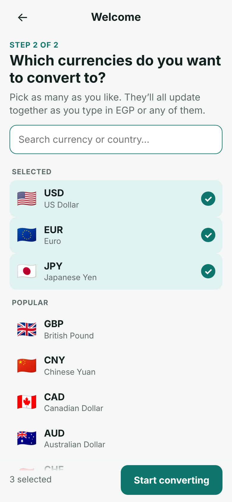
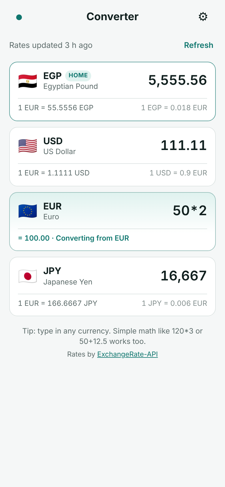
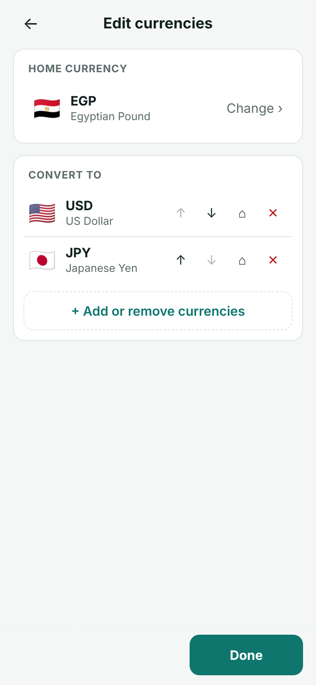

# Currency Converter

A mobile-first web app (installable PWA) that converts one amount into all of your currencies at once, using live exchange rates.

| First run | Converter | Edit currencies |
|---|---|---|
|  |  |  |

## Features

- **First-run setup**: pick your home currency (pre-selected from your device's region), then the currencies you want to convert to.
- **Remembers your choices** on the device; change them any time from the ⚙ screen (change home, add/remove, reorder, or promote a currency to home).
- **Type in any currency**: every other currency updates instantly.
- **Exchange rate per currency**, relative to the one you're typing in (e.g. `1 EUR = 55.56 EGP` and the inverse).
- **Built-in calculator**: type `120*3` or `50+12.5` and it converts the result.
- **Works offline**: the last rates are cached and the app shell is cached by a service worker; the status line shows how old the rates are.
- Light and dark mode.

## Exchange rates

Rates come from [ExchangeRate-API's open endpoint](https://www.exchangerate-api.com/docs/free) (no key, updated daily), with [fawazahmed0/exchange-api](https://github.com/fawazahmed0/exchange-api) as a fallback. Rates are refreshed when older than an hour, when the app comes back to the foreground, or when you tap **Refresh**.

## Running it

It's plain HTML/CSS/JS with no build step. Serve the folder over HTTP (ES modules and the service worker don't work from `file://`):

```sh
python3 -m http.server 8000
# or: npx serve .
```

Then open http://localhost:8000. To put it on your phone, host it anywhere static (e.g. GitHub Pages: Settings → Pages → deploy from this branch) and use "Add to Home Screen".

## Files

- `index.html`, `styles.css`: page and styling
- `app.js`: onboarding, converter and settings screens
- `currencies.js`: currency list, names, flags, decimal places
- `rates.js`: fetching, caching and converting rates
- `expr.js`: small safe calculator for the amount fields
- `sw.js`, `manifest.webmanifest`, `icon.svg`: PWA support
